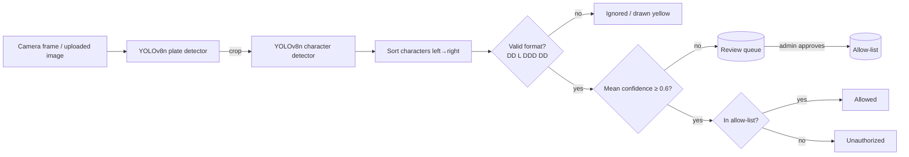

# Persian License-Plate Recognition (YOLOv8 two-stage) + Gate-Control API

Detects and reads standard Iranian private license plates from images or a live camera, checks them against an
allow-list stored in SQLite, and routes low-confidence reads to a human-review queue instead of guessing.

| | |
|---|---|
| **Detector** | YOLOv8n, 1 class (`IR_License_Plate`), 640 px |
| **Reader** | YOLOv8n character detector, 30 classes (10 digits + 20 plate letters), 800 px |
| **Backend** | FastAPI + SQLite, API-key protected, optional live camera loop |
| **Plate format handled** | `DD L DDD DD` (two digits · one letter · three digits · two-digit region code) |

> **Status.** The pipeline, API and evaluation tooling work and are tested (see [Tests](#tests)).
> Reader accuracy on a held-out test split is reported below (75.7 % exact plate match); end-to-end accuracy
> on full photos is **not yet measured** — see [Results](#results) for exactly what has and has not been measured.

---

## Demo

Left: input frame with detected plate and recognised text. Right: upscaled crop with the character boxes the second
model found. Green = output passes the plate-format check, yellow = it does not.
The ten input photos come from the MIT-licensed [Platrix](https://github.com/AliAkrami1375/Platrix) sample set
(see [`docs/demo/NOTICE.md`](docs/demo/NOTICE.md)); I have not checked whether any of them overlap with the models' training data.

**Correct reads**


**Failure cases, shown on purpose**

*Low-quality grayscale camera: a spurious extra character (`ط`) is detected on the plate's left edge. The 9-character
result is rejected by the format check and would go to human review.*


*The letter `س` is read as `ص` with mean confidence 0.85. The result has a valid format, so **nothing in the
pipeline flags it** — this is the dangerous kind of error (see [Limitations](#limitations)).*


All ten panels are in [`docs/demo/`](docs/demo/).

---

## How it works



Design decisions worth knowing:

* **Character *detection* instead of sequence OCR.** Each glyph is a YOLO box, so a plate is read by sorting boxes by
  x-coordinate. This is simple, fast and gives per-character confidences. The trade-off versus CRNN+CTC readers is
  that it can hallucinate or drop individual boxes (seen in the failure cases above).
* **`agnostic_nms=True` for the reader.** By default YOLO suppresses overlaps only *within* a class, so two different
  class guesses on the same glyph both survive, giving 9 characters and a rejected plate.
* **`imgsz=800` for the reader**, the size it was trained at (the plate detector uses its training size of 640).
* **Format gating + confidence gating.** A read is only trusted automatically if it matches the plate format *and*
  its mean character confidence is ≥ 0.6. Everything else is queued for a human (`/pending-review`).
* **Shared inference code.** `recognizer.py` is used by the API, `evaluate.py` and `demo.py`, so reported numbers come from the same code path that runs in production.
* **Thread-safe inference.** One lock serialises model calls because the camera thread and API requests share the models.
* **Timestamps are stored in local time as `YYYY-MM-DD HH:MM:SS`** and compared with SQLite's `'localtime'`, so “today” and “last 24 h” are correct around midnight.

---

## Results

### What the models achieved during training

Validation metrics recorded in each checkpoint (the validation split of each model's own training dataset — not a
held-out test set, and not end-to-end):

| Model | Epochs | imgsz | Precision | Recall | mAP50 | mAP50-95 | Params |
|---|---|---|---|---|---|---|---|
| Plate detector | 50 | 640 | 0.967 | 0.929 | 0.962 | 0.712 | 3.0 M |
| Character reader | 100 | 800 | 0.914 | 0.937 | 0.940 | 0.690 | 3.0 M |

Per-character detection quality is *not* plate-level accuracy: one wrong character out of eight ruins the plate.

### End-to-end accuracy (what actually matters)

<!-- RESULTS:START -->
**Character reader on the held-out test split** (plate crops, n = 280, reader stage only; produced with
`python evaluate.py --data <test split> --mode ocr`):

| Metric | Value |
|---|---|
| **Exact plate match** | **75.7 %** (95 % Wilson CI 70.4 %–80.4 %) |
| Character error rate (CER) | 5.3 % |
| Output has valid plate format | 84.6 % |
| Auto-accepted at conf ≥ 0.6 | 84.6 % of plates (237), **89.0 % of them correct** |
| Auto-accepted at conf ≥ 0.8 | 76.1 % of plates (213), 92.0 % of them correct |

Most frequent character errors: `3→2` (7×), `2→3` (3×), `س→ص` (2×), `2→7` (2×), `5→7` (2×) — visually similar Persian digits and letters.

Reading the table: the format check works as a safety net (nearly all plates it rejects are wrong), but the errors that
**pass** it are not separable by confidence — raising the threshold from 0.6 to 0.8 gains only 3 points of accuracy
while discarding 8 points of coverage.

**Not yet measured:** end-to-end accuracy (detector + reader) on full photos. The test split comes from the same
distribution as the training data, so accuracy on a real camera is expected to be lower.
<!-- RESULTS:END -->

**Smoke test (n = 10, *not a benchmark*).** On the ten sample photos in [`examples/sample10`](examples/sample10)
(labels written by reading the plates by eye), run through the full pipeline on CPU:

| Metric | Value |
|---|---|
| Plate detected | 10 / 10 |
| Exact plate match | 8 / 10 (95 % Wilson CI 49 %–94 %) |
| Character error rate | 2.5 % (2 edits / 80 characters) |
| Output has valid format | 9 / 10 |
| Accepted automatically at conf ≥ 0.6 | 9 / 10, of which 8 correct |

The confidence interval is wide because n is tiny; this run only shows that the toolchain works and what the errors look like
(both errors are the ones in the demo above). Full output: [`docs/results/sample10/`](docs/results/sample10/).

### Speed

Measured on **CPU only** (2 vCPU Intel Xeon @ 2.8 GHz), 640×480 images, after warm-up:
detector ≈ 120 ms + reader ≈ 72 ms per plate, ≈ 200 ms per image at p50 (≈ 5 FPS). GPU speed has not been measured.
The live-camera loop therefore processes a few frames per second on a CPU-only machine.

On an NVIDIA GeForce MX450 laptop GPU the reader alone takes ≈ 18 ms per crop (p50 15.8 ms, p95 26.9 ms; 280 crops); the detector was not timed in that run.

---

## Limitations

Read these before relying on the system.

1. **Wrong-but-valid reads are not caught.** A confusable letter (e.g. `س`↔`ص`) can be read with high confidence
   and still pass the format check. For anything security-relevant, a second signal (multi-frame agreement, a second
   model, or a human) is required. *Not implemented yet.*
2. **Single-frame decisions.** Each camera frame is decided on its own; there is no tracking or temporal voting, so a
   one-frame misread can create a spurious log entry.
3. **Only standard private plates.** The reader knows 30 classes. Taxi, government, military, diplomatic,
   motorcycle and temporary plates are not supported; the format check rejects them.
4. **Domain sensitivity.** A low-quality grayscale surveillance frame produced the extra-character failure above.
   How well the training data covers night, grayscale, blur or rain has not been characterised.
5. **No end-to-end accuracy on full photos yet.** The reported test-split numbers measure the reader alone, on crops from the training dataset's own distribution.
6. **Plates that are very small, dirty, tilted or partially occluded** have not been characterised.

---

## Quick start

Requires Python 3.10+ (tested on 3.13).

```bash
git clone <this-repo> && cd <this-repo>
python -m venv .venv && source .venv/bin/activate      # Windows: .venv\Scripts\activate
pip install -r requirements.txt
```

Model weights are expected at `models/plate/best.pt` and `models/ocr/best.pt` (override with `PLATE_MODEL_PATH` / `OCR_MODEL_PATH`).

### Try it on images

```bash
python demo.py examples/sample10 --out docs/demo          # annotated panels
```

### Run the API

```bash
export ADMIN_API_KEY="a-long-random-string"                # Windows: set ADMIN_API_KEY=...
ENABLE_CAMERA=0 uvicorn admin_api:app --host 127.0.0.1 --port 8000   # drop ENABLE_CAMERA=0 to use the webcam
```

The server **refuses to start without `ADMIN_API_KEY`**. Every endpoint except `GET /` requires the header `X-API-Key`.
Interactive docs: <http://127.0.0.1:8000/docs>.

```bash
curl -H "X-API-Key: $ADMIN_API_KEY" http://127.0.0.1:8000/stats

# add a plate to the allow-list by photographing it (rejected if the read is not a valid, confident plate)
curl -H "X-API-Key: $ADMIN_API_KEY" -F "file=@examples/sample10/sample-01.jpg" \
     "http://127.0.0.1:8000/allowed-plates/from-image?owner=Ali"
```

### API reference

| Method & path | Purpose |
|---|---|
| `GET /` | Health check (public) |
| `GET /allowed-plates` · `POST /allowed-plates?plate=…` · `DELETE /allowed-plates/{id}` | Manage the allow-list |
| `POST /allowed-plates/from-image` | Read a plate from an uploaded photo and add it (only if valid format and confidence ≥ threshold) |
| `GET /pending-review` | Low-confidence detections awaiting a decision |
| `POST /pending-review/{id}/approve` · `…/reject` | Approve (adds to allow-list) or reject a pending read |
| `GET /detections` | Last 200 detections |
| `GET /unauthorized-last-24h` | Unauthorized plates in the last 24 h, grouped, with counts |
| `GET /stats` | Today's totals, allowed / unauthorized / pending counts |
| `POST /gate/toggle?action=OPEN\|CLOSE&mode=…` | Manual gate state (state only; no hardware is driven) |
| `GET /video_feed?api_key=…` | MJPEG stream of the annotated camera feed |

### Configuration (environment variables)

| Variable | Default | Meaning |
|---|---|---|
| `ADMIN_API_KEY` | *(required)* | API key |
| `ALLOWED_ORIGINS` | `http://localhost:3000,http://localhost:5173` | CORS allow-list (comma-separated) |
| `PLATE_MODEL_PATH`, `OCR_MODEL_PATH` | `models/plate/best.pt`, `models/ocr/best.pt` | Weights |
| `DB_PATH` | `plates.db` | SQLite file (tables are created automatically) |
| `CONF_PLATE` / `CONF_CHAR` | `0.5` / `0.4` | Detector / reader confidence thresholds |
| `CONFIDENCE_THRESHOLD` | `0.6` | Mean char confidence needed for automatic acceptance |
| `OCR_IMGSZ` | `800` | Reader inference size (keep equal to training size) |
| `DEDUP_SECONDS` | `10` | Don't log the same plate text more than once per N s |
| `ENABLE_CAMERA`, `CAMERA_INDEX` | `1`, `0` | Live camera loop |
| `FONT_PATH` | Tahoma / DejaVu fallback | Font for drawing Persian text on frames |

Copy `.env.example` to `.env` for a template.

---

## Evaluation

`evaluate.py` measures what the demo can't: exact plate match with a 95 % Wilson interval, character error rate,
the coverage/accuracy trade-off of the confidence gate, top character confusions, and latency.

Two ground-truth formats:

```bash
# 1) CSV: filename,plate     (plate text like 42د61613)
python evaluate.py --csv labels.csv --images path/to/images --out docs/results/test

# 2) YOLO layout: DIR/images/*.jpg + DIR/labels/*.txt using the reader's class ids
#    (a data.yaml next to them is checked against the model's class order)
python evaluate.py --data path/to/test_split --out docs/results/test --save-errors 20

# Isolate the reader: images are already plate crops
python evaluate.py --data path/to/crop_test_split --mode ocr
```

Outputs `results.md`, `results.json`, `errors.csv` (every wrong plate) and, with `--save-errors N`, annotated failure panels.

**Use images that were not in the training or validation split** — otherwise the numbers are inflated.
Assumes one plate per image; if several are present the most confident detection is scored.

## Tests

```bash
pytest -q          # 24 tests: auth, CORS, time filters, validation, metric maths, smoke-set regression
```

## Repository layout

```
admin_api.py        FastAPI app, SQLite, camera loop
recognizer.py       two-stage inference (shared by everything)
viz.py              Persian text rendering on OpenCV frames
demo.py             annotated demo panels
evaluate.py         accuracy / CER / coverage / latency
models/{plate,ocr}/ weights
examples/sample10/  10 public photos + labels (smoke test only)
docs/demo/          demo panels      docs/results/   evaluation outputs
tests/              pytest suite
```

## Data & provenance

The training checkpoints record these YOLO-format datasets: *Persian-Car-Numbers v3* (character reader) and
*Iranian Plate v3 – ilpv3* (plate detector). Check each dataset's licence before redistributing the weights.
Demo images: see [`docs/demo/NOTICE.md`](docs/demo/NOTICE.md).

## Roadmap

1. Publish end-to-end accuracy on a held-out test set (tooling is ready).
2. Multi-frame tracking with per-character voting to remove one-frame misreads.
3. Constrained decoding: when the reader returns more than 8 characters, drop the least-confident one if that yields a valid plate (evaluate with/without).
4. Compare against a CRNN+CTC reader on the same test set.
5. Support more plate types (taxi, government, motorcycle).
